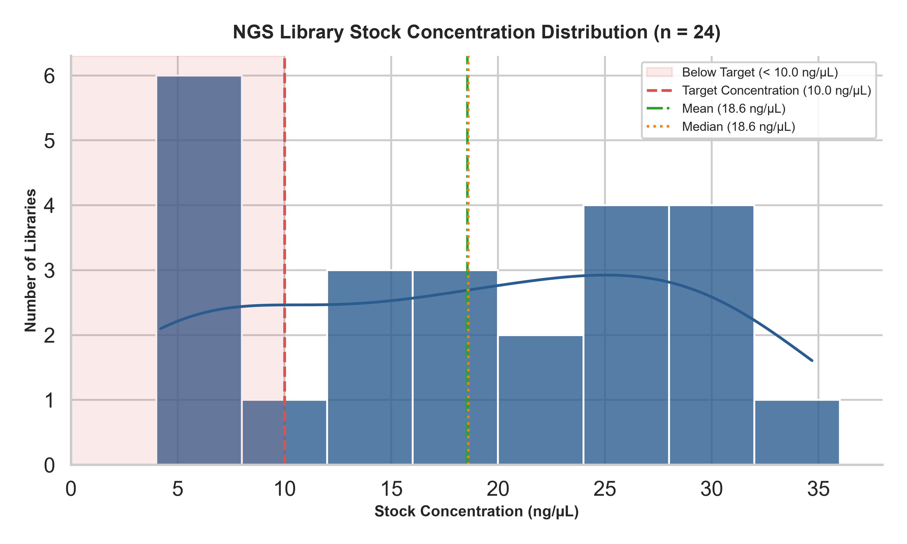
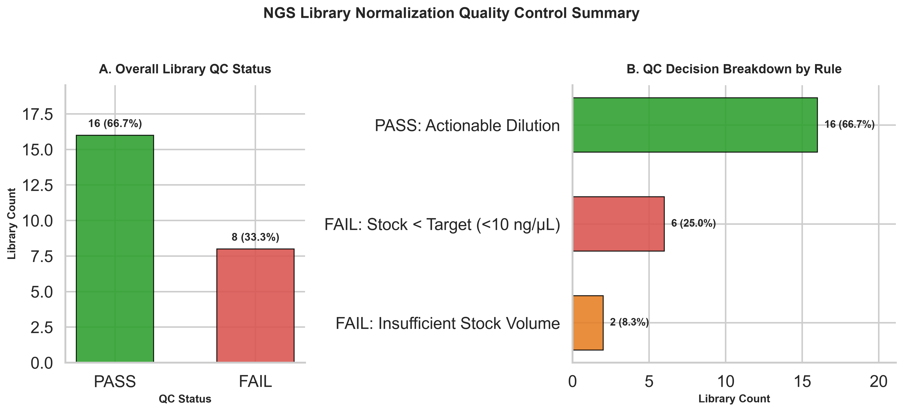
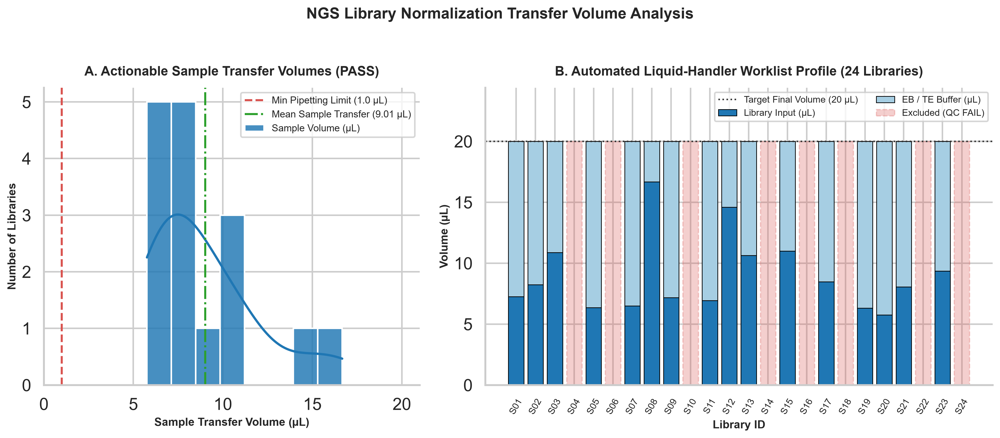

# NGS Library Normalization & Liquid-Handling Automation QC

[](https://www.python.org/)
[](https://opensource.org/licenses/MIT)
[]()

A production-grade **computational quality-control (QC) and automated liquid-handling worklist generator** for Next-Generation Sequencing (NGS) library normalization. This pipeline bridges wet-lab fluorometric quantification (e.g., Qubit dsDNA HS/BR, PicoGreen) and automated liquid-handling platforms (e.g., Hamilton Microlab STAR, Beckman Biomek, Opentrons Flex/OT-2) by validating dilution math, enforcing hardware pipetting constraints, and preventing invalid transfer instructions before pooling.

---

## Scientific & Wet-Lab Background

### Why Library Normalization Matters in NGS
Uniform cluster density (Illumina SBS) or pore occupancy (Oxford Nanopore) across multiplexed samples requires each library in a sequencing pool to be normalized to an identical target concentration prior to pooling. Without rigorous normalization:
- **Over-represented libraries** consume a disproportionate share of sequencing reads, inflating per-sample costs.
- **Under-represented libraries** fail to reach minimum coverage depth thresholds (e.g., $<30\times$ for germline WGS or $<500\times$ for somatic cell-free DNA panels), causing false-negative variant calls.
- **Unvalidated automated pipetting plans** can command liquid handlers to aspirate more volume than physically present in a source well (air aspiration / crash) or compute physically impossible **negative buffer volumes** when a sample's initial stock concentration is below the target concentration.

### Mathematical Formulation

#### 1. Mass-Concentration Dilution ($C_1 V_1 = C_2 V_2$)
For workflows normalizing to a standardized mass concentration (e.g., $C_2 = 10.0\text{ ng/\mu L}$ in a final reaction volume $V_2 = 20.0\text{ \mu L}$, corresponding to $200\text{ ng}$ total DNA mass):

$$V_{\text{sample}} = \frac{C_{\text{target}} \times V_{\text{final}}}{C_{\text{stock}}}, \qquad V_{\text{buffer}} = V_{\text{final}} - V_{\text{sample}}$$

#### 2. Relationship to Molarity ($\text{nM}$) for Equimolar Pooling
When fragment size distributions vary across libraries (measured via Agilent TapeStation / Bioanalyzer / Fragment Analyzer), mass concentration ($\text{ng/\mu L}$) is converted to molarity ($\text{nM}$) using the average dsDNA molecular weight ($\approx 660\text{ g/mol per bp}$):

$$\text{Concentration (nM)} = \frac{\text{Concentration (ng/\mu L)}}{660\text{ g/mol/bp} \times \text{Average Fragment Size (bp)}} \times 10^6$$

When fragment sizes are uniform across a library prep batch (e.g., fixed-size PCR amplicon panels or standardized enzymatic fragmentation), normalizing to a uniform mass concentration ($\text{ng/\mu L}$) directly achieves equimolar normalization.

---

## Automated QC Decision Engine

Unlike naive spreadsheet formulas that blindly output $V_{\text{buffer}} = V_{\text{final}} - V_{\text{sample}}$, `scripts/normalize_libraries.py` enforces strict multi-stage validation rules tailored for automated liquid handlers:

| Rule Priority | QC Failure Code | Physical / Analytical Condition | Liquid-Handling Consequence Prevented |
| :--- | :--- | :--- | :--- |
| **1** | `missing_sample_id` / `duplicate_sample_id` | Blank or repeated sample identifier in plate manifest | Barcode collision / sample swap on deck |
| **2** | `invalid_concentration` / `invalid_available_volume` | Non-numeric, `NaN`, `Inf`, or non-positive measurement | Arithmetic exception in robot worklist |
| **3** | `stock_below_target` | $C_{\text{stock}} < C_{\text{target}}$ ( implies $V_{\text{sample}} > V_{\text{final}}$ and $V_{\text{buffer}} < 0$) | Physically impossible "negative buffer" dilution (requires vacuum concentration or re-prep) |
| **4** | `insufficient_volume` | Rounded $V_{\text{sample}} > V_{\text{available}}$ | Aspiration of air, foam generation, or dead-volume starvation |
| **5** | `sample_below_min_transfer` / `buffer_below_min_transfer` | $0 < V_{\text{transfer}} < V_{\text{min}}$ (default $1.0\text{ \mu L}$) | High coefficient of variation ($\%CV > 10\%$) below air-displacement pipette spec |
| **6** | `rounding_out_of_tolerance` | $\frac{\lvert C_{\text{predicted}} - C_{\text{target}}\rvert}{C_{\text{target}}} \times 100 > \epsilon_{\max}$ (default $0.5\%$) | Concentration drift due to $0.01\text{ \mu L}$ step discretization |

> **Safety Guarantee:** For any sample flagged as `FAIL`, actionable pipetting columns (`sample_volume_ul` and `buffer_volume_ul`) are left intentionally **blank** so downstream liquid-handling parsers cannot accidentally execute an invalid transfer, while `required_sample_volume_ul` is preserved for diagnostic review.

---

## Repository Structure

```text
library-normalization-qc/
├── .github/workflows/
│   └── tests.yml                             # Automated CI test matrix (Python 3.10–3.13)
├── data/
│   └── raw/
│       └── sample_sheet.csv                  # Input fluorometric quantification & volume manifest (24 libraries)
├── notebooks/
│   └── library_normalization.ipynb           # Interactive exploratory analysis & QC walkthrough
├── results/
│   ├── normalized_samples.csv                # Validated liquid-handler transfer worklist & per-sample QC status
│   ├── qc_summary.json                       # Machine-readable batch QC summary & failure breakdown
│   ├── concentration_distribution.png        # Stock concentration histogram & KDE with target floor
│   ├── pass_fail.png                         # Overall QC Pass/Fail & failure rule breakdown plot
│   └── transfer_volume_distribution.png      # Pipetting volume distribution & 24-well worklist profile
├── scripts/
│   ├── generate_samples.py                   # Synthetic library cohort generator with reproducible seed
│   ├── normalize_libraries.py                # Core CLI normalization & QC validation engine
│   ├── plot_concentrations.py                # Stock concentration distribution visualization script
│   ├── pass_fail_plot.py                     # QC decision & failure breakdown visualization script
│   └── transfer_volume_plot.py               # Transfer volume & stacked worklist visualization script
├── tests/
│   └── test_normalization.py                 # Unit & edge-case regression test suite (13 tests)
├── requirements.txt                          # Pinned Python dependencies for reproducibility
└── README.md                                 # Project documentation & analytical report
```

---

## Installation & Execution

### 1. Environment Setup
Clone the repository and install pinned dependencies (Python 3.10+):

```bash
git clone https://github.com/denisulko/library-normalization-qc.git
cd library-normalization-qc
pip install -r requirements.txt
```

### 2. Run the Normalization & QC Engine
Execute the core CLI planner using default parameters ($C_{\text{target}} = 10.0\text{ ng/\mu L}$, $V_{\text{final}} = 20.0\text{ \mu L}$, $V_{\text{min}} = 1.0\text{ \mu L}$, tolerance $= 0.5\%$):

```bash
python scripts/normalize_libraries.py \
  --input data/raw/sample_sheet.csv \
  --output results/normalized_samples.csv \
  --summary results/qc_summary.json \
  --target-ng-ul 10.0 \
  --final-volume-ul 20.0 \
  --min-transfer-ul 1.0 \
  --max-error-pct 0.5
```

For automated LIMS/CI integration, append `--strict` to return exit code `1` whenever one or more libraries fail QC.

### 3. Generate Analytical Visualizations
Regenerate all publication-quality plots in `results/`:

```bash
python scripts/plot_concentrations.py
python scripts/pass_fail_plot.py
python scripts/transfer_volume_plot.py
```

### 4. Run Automated Unit & Regression Tests
Verify edge-case handling and mathematical accuracy using the standard-library test suite:

```bash
python -m unittest discover -s tests -v
```

---

## Results & Analytical Interpretation

### 1. Stock Concentration Distribution (`data/raw/sample_sheet.csv`)



**Analytical Interpretation:**
- Across the 24-library batch (`S01`–`S24`), fluorometric stock concentrations span **4.2 ng/µL to 34.7 ng/µL**, with a batch mean of **18.6 ng/µL** and median of **18.6 ng/µL**.
- The distribution exhibits bimodal clustering: a high-yield library cluster ($18\text{–}35\text{ ng/\mu L}$) from robust PCR/tagmentation amplification, and a low-yield tail ($4.2\text{–}6.0\text{ ng/\mu L}$, shaded red) falling below the **10.0 ng/µL target threshold**.
- **6 libraries (`S04`, `S06`, `S10`, `S16`, `S18`, `S22`)** have stock concentrations below $10.0\text{ ng/\mu L}$. Because aqueous buffer addition can only *decrease* concentration, these samples cannot reach $10.0\text{ ng/\mu L}$ via dilution. Notably, naive spreadsheet formulas previously marked `S18` ($5.8\text{ ng/\mu L}$, $34.7\text{ \mu L}$ stock) and `S22` ($6.0\text{ ng/\mu L}$, $37.0\text{ \mu L}$ stock) as `PASS` because their available volume exceeded the required $34.48\text{ \mu L}$ and $33.33\text{ \mu L}$ DNA input—ignoring that they required **$-14.48\text{ \mu L}$ and $-13.33\text{ \mu L}$ of buffer**. Our QC engine properly flags all 6 as `FAIL (stock_below_target)`.

---

### 2. Quality Control Pass/Fail Summary & Rule Breakdown



**Analytical Interpretation:**
- **Overall Yield:** **16 of 24 libraries (66.7%) PASS** all normalization criteria and receive executable transfer volumes, while **8 libraries (33.3%) FAIL** and are quarantined for manual review.
- **Failure Mode 1 — `stock_below_target` (6 libraries, 25.0%):** Libraries `S04` ($4.8\text{ ng/\mu L}$), `S06` ($4.2\text{ ng/\mu L}$), `S10` ($5.5\text{ ng/\mu L}$), `S16` ($4.2\text{ ng/\mu L}$), `S18` ($5.8\text{ ng/\mu L}$), and `S22` ($6.0\text{ ng/\mu L}$). **Recommended Wet-Lab Remediation:** Either pool these libraries at a lower secondary tier (e.g., $4.0\text{ ng/\mu L}$ target pool), concentrate via SpeedVac / SPRI bead low-volume elution, or repeat library amplification.
- **Failure Mode 2 — `insufficient_volume` (2 libraries, 8.3%):** Libraries `S14` ($11.2\text{ ng/\mu L}$, $11.6\text{ \mu L}$ available vs. $17.86\text{ \mu L}$ required) and `S24` ($15.6\text{ ng/\mu L}$, $10.7\text{ \mu L}$ available vs. $12.82\text{ \mu L}$ required) have adequate concentration ($\ge 10\text{ ng/\mu L}$) but insufficient eluate volume to supply $200\text{ ng}$ of total DNA. **Recommended Wet-Lab Remediation:** Scale down final normalization volume from $20.0\text{ \mu L}$ to $10.0\text{ \mu L}$ ($100\text{ ng}$ total mass), which requires only $8.93\text{ \mu L}$ for `S14` and $6.41\text{ \mu L}$ for `S24`—rescuing both samples without re-extraction.

---

### 3. Liquid-Handler Transfer Volume Profile



**Analytical Interpretation:**
- Among the **16 passing libraries**, required DNA transfer volumes range from **5.76 µL (`S20`, 34.7 ng/µL)** to **16.67 µL (`S08`, 12.0 ng/µL)**, with a mean DNA transfer of **9.01 µL** and mean buffer addition of **10.99 µL**.
- Every passing transfer comfortably exceeds the **1.0 µL minimum pipetting threshold**, ensuring high volumetric precision on standard 10–50 µL air-displacement channels.
- Post-rounding predicted concentrations across all 16 passing libraries lie between **9.9936 ng/µL and 10.0056 ng/µL** ($\le 0.06\%$ deviation from the $10.0\text{ ng/\mu L}$ target), well inside the $0.5\%$ tolerance specification.
